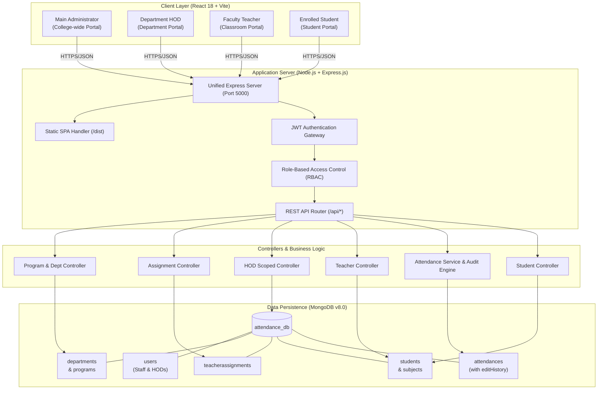
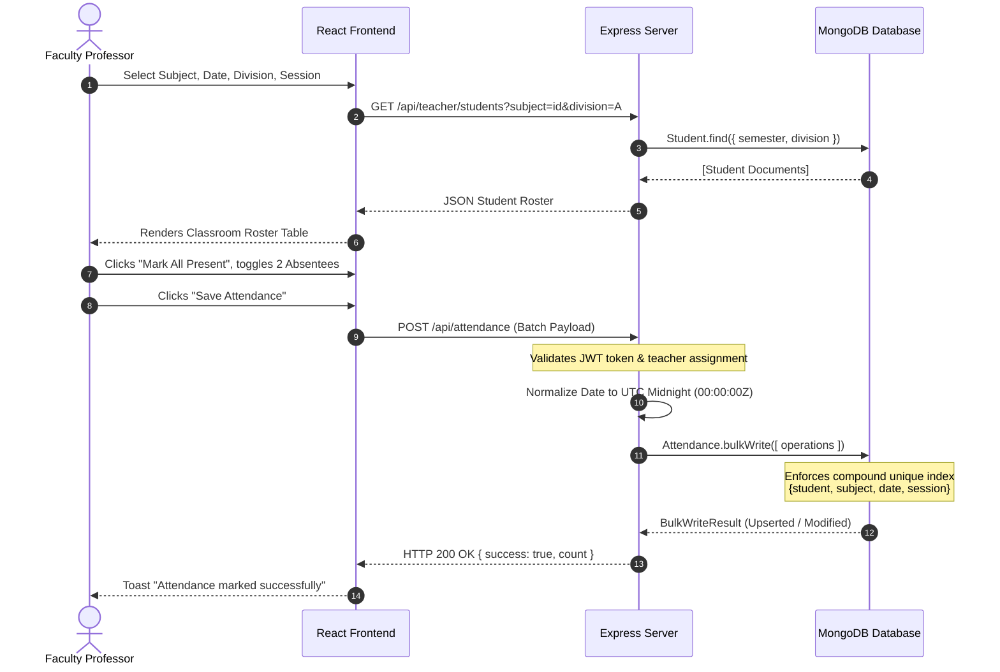
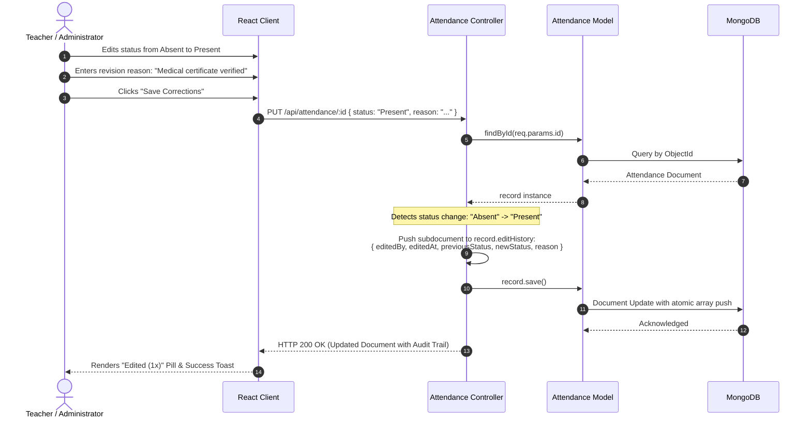
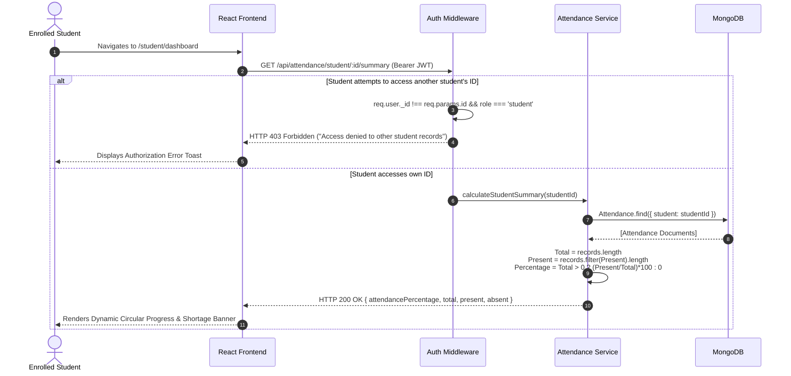
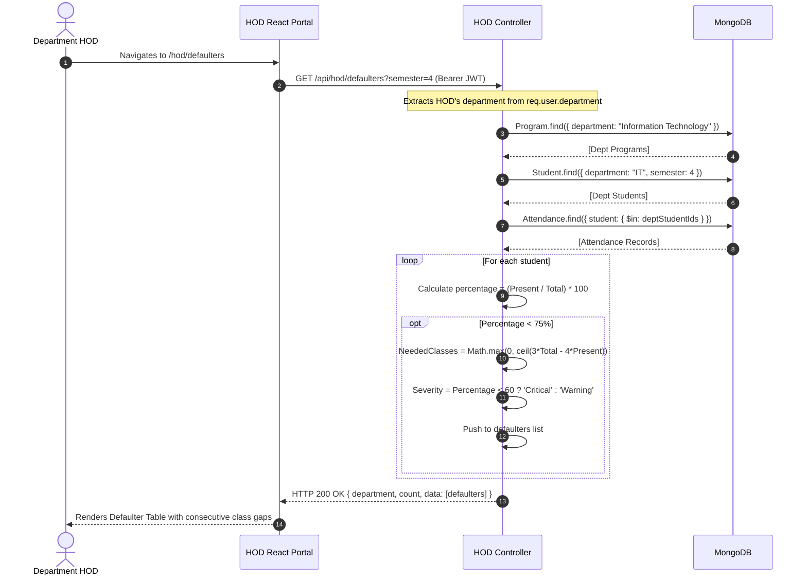
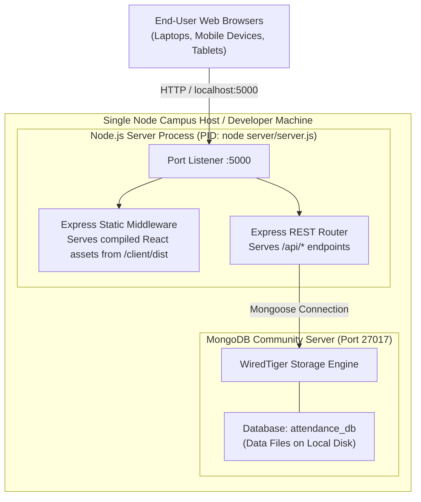

# System Architecture Document
## Attendance Management System (AMS) — MERN Platform

**Document Version:** 2.2.0  
**Date:** October 2026  
**Author:** Ayush Shedge  
**Degree:** B.Sc. Information Technology  
**Institution:** Vidyalankar School of Information Technology, Mumbai  
**GitHub Repository:** [https://github.com/ayushshedge24-tech/attendance-management-system-mern](https://github.com/ayushshedge24-tech/attendance-management-system-mern)  

---

## 1. High-Level Architectural Context

The **Attendance Management System (AMS)** is engineered as a decoupled, multi-tier Single Page Application (SPA) driven by a RESTful backend API. The system orchestrates four role-isolated portals (Main Admin, Department HOD, Faculty Teacher, and Student) operating over a unified MongoDB Community database.

---

## 2. Component & Layer Architecture

```mermaid
flowchart LR
    subgraph Presentation ["Presentation Layer (React 18)"]
        direction TB
        UI1["AuthContext & ToastContext"]
        UI2["ProtectedRoute (RBAC Guard)"]
        UI3["DashboardLayout (Responsive Sidebar)"]
        UI4["Pages (Admin, HOD, Teacher, Student)"]
        UI5["Axios Client (Bearer Interceptor)"]
        UI1 --> UI2 --> UI3 --> UI4 --> UI5
    end

    subgraph ServerLayer ["Server Layer (Express.js)"]
        direction TB
        S1["server.js (Static & CORS)"]
        S2["authMiddleware (JWT Verify)"]
        S3["roleMiddleware (RBAC Guard)"]
        S4["Express Routers"]
        S5["Controllers & Services"]
        S1 --> S2 --> S3 --> S4 --> S5
    end

    subgraph DataLayer ["Persistence Layer (Mongoose + MongoDB)"]
        direction TB
        M1["Mongoose Models & Hooks"]
        M2["Compound Unique Indexes"]
        M3["MongoDB Storage Engine (WiredTiger)"]
        M1 --> M2 --> M3
    end

    UI5 -->|HTTP REST| S1
    S5 -->|ODM Queries| M1
```

---

## 3. Role-Based Portal Architecture & Routing

```mermaid
flowchart TD
    Login["/login (LoginPage.jsx)\nDual ID Authentication"]
    
    Login -->|Role: 'admin'| ADM["/admin/dashboard\nMain Admin Portal"]
    Login -->|Role: 'hod'| HOD["/hod/dashboard\nDepartment HOD Portal"]
    Login -->|Role: 'teacher'| TCH["/teacher/dashboard\nFaculty Teacher Portal"]
    Login -->|Role: 'student'| STU["/student/dashboard\nStudent Portal"]

    subgraph AdminPortal ["Admin Protected Routes"]
        ADM --> P1["/admin/programs (8 Programs + Depts)"]
        ADM --> P2["/admin/assignments (Teacher Allocations)"]
        ADM --> P3["/admin/students (Student CRUD)"]
        ADM --> P4["/admin/subjects (Subject CRUD)"]
        ADM --> P5["/admin/attendance-records (Audit Logs)"]
        ADM --> P6["/admin/reports (College Reports)"]
    end

    subgraph HodPortal ["HOD Protected Routes"]
        HOD --> H1["/hod/students (Department Students)"]
        HOD --> H2["/hod/teachers (Department Faculty)"]
        HOD --> H3["/hod/subjects (Department Courses)"]
        HOD --> H4["/hod/defaulters (Defaulters < 75%)"]
        HOD --> H5["/hod/reports (Department Reports)"]
    end

    subgraph TeacherPortal ["Teacher Protected Routes"]
        TCH --> T1["/teacher/subjects (Assigned Classes)"]
        TCH --> T2["/teacher/mark-attendance (Batch Marking)"]
        TCH --> T3["/teacher/edit-attendance (Audit Updates)"]
        TCH --> T4["/teacher/absent-students (Defaulters)"]
        TCH --> T5["/teacher/reports (Classroom Reports)"]
    end

    subgraph StudentPortal ["Student Protected Routes"]
        STU --> S1["/student/attendance (Day-wise Ledger)"]
        STU --> S2["/student/subjects (Subject Percentages)"]
        STU --> S3["/student/monthly (Monthly Trends)"]
        STU --> S4["/student/profile (Academic Info)"]
    end
```

---

## 4. Sequence Diagrams

### 4.1 Batch Attendance Marking Sequence

### 4.2 Attendance Correction with Audit Trail Logging

### 4.3 Student Dashboard Calculation & Security Boundary

### 4.4 HOD Defaulter Detection & Scoped Department Query

---

## 5. Deployment Topology

The application supports a unified single-port architecture ideal for campus intranet deployment:

---

## 6. Security Architecture

1. **Authentication:** Stateless JSON Web Token signed with HMAC-SHA256 using `JWT_SECRET`.
2. **Password Security:** Salted hashes generated using `bcryptjs` with 10 salt rounds. Passwords are never stored or transmitted in plain text.
3. **Role-Based Access Control:** Dual-layer enforcement:
   - Client-side: `<ProtectedRoute allowedRoles={[...]} />` redirects unauthorized users.
   - Server-side: `roleMiddleware.js` verifies permissions before controller invocation.
4. **Data Isolation:** Strict identity checking ensures that students cannot read or write records belonging to other students.
5. **NoSQL Injection Defense:** Mongoose schema casting and strict sanitization ensure malicious query operators are rejected.
