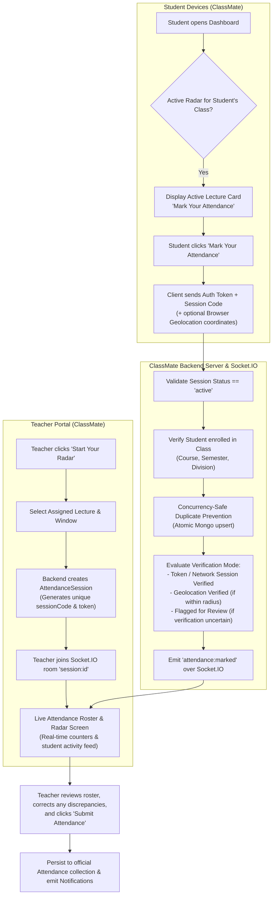

# ClassMate — Project Transformation Plan & Implementation Checklist
## Smart College Attendance Management System

**Project:** ClassMate (formerly Attendance Management System — MERN)  
**Date:** October 2026  
**Version:** 3.0.0-PRO  
**Author:** Senior Full-Stack MERN Architect & QA Lead  

---

## 1. Codebase Discovery & Feature Classification

| Module / Feature | Current State | Target State in ClassMate | Classification |
| :--- | :--- | :--- | :--- |
| **Branding & Logo** | Generic "AMS Portal" / "Attendance Management System" | **ClassMate: Smart College Attendance Management System** with dedicated logo, favicon, and responsive branding | 🔄 Needs Improvement |
| **Authentication & RBAC** | JWT (Admin, HOD, Teacher, Student) + Rate Limiting | Preserved & extended to Timetable, Radar sessions, and Notifications | ✅ Already Working |
| **Academic Hierarchy** | 4 Departments, 8 Programs, Divisions A–D, 5 Subjects | Preserved; add Timetable entries, classrooms, and lecture slot associations | ✅ Already Working / Extending |
| **Smart Attendance Radar** | Non-existent (manual batch marking only) | **Full real-time Radar workflow**: Teacher "Start Your Radar" + Students "Mark Your Attendance" + Socket.IO live roster + manual correction + Final submission | 🆕 Missing (Primary New Feature) |
| **Real-time Live Sync** | None (REST-only) | **Socket.IO WebSockets**: instant live attendance feed without manual refresh | 🆕 Missing (Implemented in Phase 5) |
| **Timetable System** | Static / non-existent model | Database-backed Timetable for students and teachers (Mon–Sat, classrooms, auto-suggestion) | 🆕 Missing (Implemented in Phase 11) |
| **Notifications System** | Toast-only during active session | Database-backed persistent Notifications for attendance events, radar alerts, corrections | 🆕 Missing (Implemented in Phase 12) |
| **Student Dashboard** | Overall %, subject cards, monthly summary | Enhanced ClassMate dashboard with Active Radar card, Timetable widget, notifications | 🔄 Needs Improvement |
| **Teacher Dashboard** | Assigned subjects, batch marking, reports | Enhanced with prominent "Start Your Radar", live radar monitor, and timetable schedule | 🔄 Needs Improvement |
| **HOD & Admin Portals** | Department/College oversight, CSV export, assignments | Enhanced with Timetable administration and ClassMate branding | 🔄 Needs Improvement |
| **Audit Trail Engine** | Revision history in `Attendance.js` | Preserved and integrated with final Radar session submissions | ✅ Already Working |
| **Data Preservation** | 1,064 records in `attendance_db` | Strictly preserved with zero deletions | 🔒 Protected |

---

## 2. Smart Attendance Radar: Realistic Architecture Evaluation

Per Phase 6 requirements, no fake radar animations claiming impossible hardware capabilities will be presented:

### Realistic Device & Network Capabilities:
- **Standard Web Browsers (Chrome, Safari, Edge, Firefox):** Web applications running in standard mobile or desktop browsers cannot automatically enumerate nearby Bluetooth or Wi-Fi MAC addresses due to OS-level security sandboxing.
- **ClassMate Verified Solution:**
  1. **Cryptographic Radar Session Token & Code:** The teacher's session broadcasts an active session code. Students logged into the matching class and division are alerted in real time.
  2. **Concurrent Asynchronous Submission:** Multiple students can submit simultaneously without blocking.
  3. **W3C Geolocation API Verification:** If the institution configures classroom coordinates, the student's browser requests location with explicit user permission, and the server calculates the haversine distance (e.g. within 100 meters).
  4. **Network / IP Token Verification:** Submissions record IP and timestamp. If location is unavailable or denied, the system marks the method as `"Network Verified"` or `"Requires Teacher Review"` rather than fabricating a fake location.
  5. **Teacher Manual Review & Final Submission:** The teacher has final verification authority to approve or adjust statuses before final submission.

---

## 3. Prioritized Implementation Checklist

- [ ] **Step 1: ClassMate Branding & Assets**
  - Create reusable `ClassMateLogo` component with modern educational radar branding.
  - Create `client/public/favicon.svg` with ClassMate icon.
  - Update `index.html` title and metadata.
  - Update `LoginPage.jsx`, `DashboardLayout.jsx`, sidebars, headers, and footer attributions.
- [ ] **Step 2: Database Models for New Capabilities**
  - Create `server/models/Timetable.js` (Classroom, day of week, time slots, teacher, subject, course, semester, division).
  - Create `server/models/AttendanceSession.js` (Radar session lifecycle, unique session code, attendees array, review status, final submission lock).
  - Create `server/models/Notification.js` (Persistent student & teacher notifications, read/unread status).
- [ ] **Step 3: Real-Time Socket.IO Integration**
  - Integrate `socket.io` into `server/server.js` with HTTP server instance.
  - Implement authenticated socket rooms: `session:<sessionId>` and `user:<userId>`.
  - Handle live events: `join_session`, `leave_session`, `attendance_marked_live`, `session_status_changed`.
- [ ] **Step 4: Smart Attendance Radar Controllers & Routes**
  - `POST /api/radar/session/start` (Teacher starts radar session).
  - `GET /api/radar/session/active` (Check active session for student's class).
  - `POST /api/radar/session/mark` (Student marks attendance; concurrent & duplicate safe).
  - `GET /api/radar/session/:sessionId/live` (Teacher gets live roster & counters).
  - `PUT /api/radar/session/:sessionId/attendee/:studentId` (Teacher manual correction).
  - `POST /api/radar/session/:sessionId/submit` (Teacher submits final attendance; locks session, updates official Attendance records).
- [ ] **Step 5: Timetable System Controllers & Routes**
  - `GET /api/timetable/student` (Student's weekly schedule & today's lectures).
  - `GET /api/timetable/teacher` (Teacher's weekly schedule & active/next lecture).
  - `GET /api/timetable/department` (HOD departmental timetable).
  - `POST /api/timetable`, `PUT /api/timetable/:id`, `DELETE /api/timetable/:id` (Admin/HOD timetable management with collision detection).
  - Seed initial timetable entries for existing subjects and teachers.
- [ ] **Step 6: Notifications System Controllers & Routes**
  - `GET /api/notifications` (List user's notifications, unread count).
  - `PUT /api/notifications/:id/read` & `PUT /api/notifications/read-all`.
- [ ] **Step 7: Student Dashboard Transformation**
  - Add Active Radar Card with "Mark Your Attendance" modal and real-time status.
  - Add Today's Schedule / Timetable widget.
  - Add Notifications bell with unread badge and dropdown in topbar.
  - Enhance subject cards and attendance trend charts.
- [ ] **Step 8: Teacher Dashboard & Radar Studio Transformation**
  - Add "Start Your Radar" quick action & today's schedule.
  - Create dedicated **Radar Studio** view (`/teacher/radar` or modal): live radar pulse animation, real-time attendee list via Socket.IO, manual status toggle, review filters, and "Submit Attendance" workflow.
  - Add weekly timetable view (`/teacher/timetable`).
- [ ] **Step 9: HOD & Admin Dashboard Upgrades**
  - Add Timetable Management page (`/admin/timetable` and `/hod/timetable`).
  - Add Radar Session logs oversight.
- [ ] **Step 10: Automated Testing Suite & Build Verification**
  - Add E2E tests in `server/test_api.js` for Timetable, Radar sessions, concurrent marking, duplicate prevention, Socket.IO live sync, notifications, and security boundaries.
  - Verify `npm run build --prefix client`.
- [ ] **Step 11: Final Delivery & Documentation**
  - Update `README.md` and docs.
