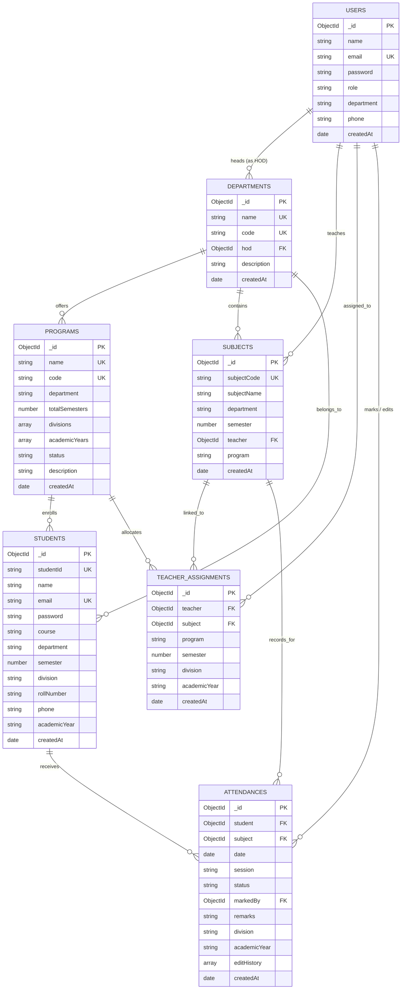

# Database Design Document
## Attendance Management System (AMS) — MongoDB Database Architecture

**Document Version:** 2.2.0  
**Date:** October 2026  
**Author:** Ayush Shedge  
**Degree:** B.Sc. Information Technology  
**Institution:** Vidyalankar School of Information Technology, Mumbai  
**Database Name:** `attendance_db`  
**Connection URI:** `mongodb://127.0.0.1:27017/attendance_db`  
**ODM:** Mongoose v8.9  

---

## 1. Database Overview & Strategy

The Attendance Management System stores all academic entities, user credentials, faculty allocations, and instructional records in a dedicated MongoDB database named `attendance_db`. 

MongoDB was selected for:
1. **Flexible Document Schemas:** Accommodating embedded audit arrays and configurable division/semester lists without altering static table schemas.
2. **High-Throughput Bulk Writes:** Supporting `bulkWrite` operations for class-wide attendance marking in a single network round-trip.
3. **Compound Index Enforcement:** Guaranteeing multi-field uniqueness (e.g. preventing duplicate records for the same student, subject, date, and lecture session).

---

## 2. Entity-Relationship Diagram (ERD)



---

## 3. Detailed Collection Schemas

### 3.1 `users` Collection (Staff Accounts)
Stores administrator, department head (HOD), and faculty teacher accounts.

| Field Name | BSON Type | Constraints & Defaults | Description |
| :--- | :--- | :--- | :--- |
| `_id` | `ObjectId` | Auto-generated Primary Key | Unique document identifier |
| `name` | `String` | Required, Trimmed | Full name of staff member |
| `email` | `String` | Required, Unique, Lowercase, Trimmed | Official institutional email address |
| `password` | `String` | Required, Select: `false` | 10-round bcrypt salted hash |
| `role` | `String` | Required, Enum: `['admin', 'hod', 'teacher']`, Default: `'teacher'` | Security access tier |
| `department` | `String` | Optional, Trimmed | Academic department affiliation |
| `phone` | `String` | Optional, Trimmed | Contact phone number |
| `createdAt` | `Date` | Default: `Date.now` | Account creation timestamp |
| `updatedAt` | `Date` | Default: `Date.now` | Last profile update timestamp |

**Pre-Save Hook:**
```javascript
userSchema.pre('save', async function (next) {
  if (!this.isModified('password')) return next();
  const salt = await bcrypt.genSalt(10);
  this.password = await bcrypt.hash(this.password, salt);
});
```

---

### 3.2 `departments` Collection (Academic Departments)
Stores institutional academic departments.

| Field Name | BSON Type | Constraints & Defaults | Description |
| :--- | :--- | :--- | :--- |
| `_id` | `ObjectId` | Auto-generated Primary Key | Unique document identifier |
| `name` | `String` | Required, Unique, Trimmed | e.g. "Information Technology" |
| `code` | `String` | Required, Unique, Uppercase, Trimmed | e.g. "IT" |
| `hod` | `ObjectId` | Ref: `'User'`, Nullable, Default: `null` | Reference to appointed Head of Department |
| `description` | `String` | Optional, Trimmed | Department jurisdiction description |
| `createdAt` | `Date` | Default: `Date.now` | Department creation timestamp |
| `updatedAt` | `Date` | Default: `Date.now` | Last update timestamp |

---

### 3.3 `programs` Collection (College Degree Programs)
Stores degree courses with Divisions A–D and configurable terms.

| Field Name | BSON Type | Constraints & Defaults | Description |
| :--- | :--- | :--- | :--- |
| `_id` | `ObjectId` | Auto-generated Primary Key | Unique document identifier |
| `name` | `String` | Required, Unique, Trimmed | e.g. "B.Sc. IT", "M.Tech" |
| `code` | `String` | Required, Unique, Uppercase, Trimmed | e.g. "BSCIT", "MTECH" |
| `department` | `String` | Required, Trimmed | e.g. "Information Technology" |
| `totalSemesters` | `Number` | Required, Default: `6`, Range: 1–10 | Duration of degree in semesters |
| `divisions` | `Array of Strings` | Default: `['A', 'B', 'C', 'D']` | Supported classroom divisions |
| `academicYears` | `Array of Strings` | Default: `['2026-2027', '2025-2026']` | Active academic evaluation sessions |
| `description` | `String` | Optional, Trimmed | Program guidelines and overview |
| `status` | `String` | Enum: `['Active', 'Inactive']`, Default: `'Active'` | Academic status |
| `createdAt` | `Date` | Default: `Date.now` | Creation timestamp |
| `updatedAt` | `Date` | Default: `Date.now` | Last update timestamp |

---

### 3.4 `teacherassignments` Collection (Faculty Class Allocations)
Maps professors to courses, programs, semesters, divisions, and academic years.

| Field Name | BSON Type | Constraints & Defaults | Description |
| :--- | :--- | :--- | :--- |
| `_id` | `ObjectId` | Auto-generated Primary Key | Unique document identifier |
| `teacher` | `ObjectId` | Required, Ref: `'User'` | Allocated professor |
| `subject` | `ObjectId` | Required, Ref: `'Subject'` | Allocated curriculum course |
| `program` | `String` | Required, Default: `'B.Sc. IT'` | Target degree program |
| `semester` | `Number` | Required, Range: 1–10 | Target semester term |
| `division` | `String` | Required, Enum: `['A', 'B', 'C', 'D']` | Target classroom division |
| `academicYear` | `String` | Required, Default: `'2026-2027'` | Target academic session |
| `createdAt` | `Date` | Default: `Date.now` | Allocation timestamp |
| `updatedAt` | `Date` | Default: `Date.now` | Last update timestamp |

**Compound Unique Index:**
`{ teacher: 1, subject: 1, division: 1, academicYear: 1 }` (Unique: `true`)

---

### 3.5 `students` Collection (Enrolled Students)
Stores student academic information and authentication credentials.

| Field Name | BSON Type | Constraints & Defaults | Description |
| :--- | :--- | :--- | :--- |
| `_id` | `ObjectId` | Auto-generated Primary Key | Unique document identifier |
| `studentId` | `String` | Required, Unique, Uppercase, Trimmed | Official ID, e.g. `STU1001` |
| `name` | `String` | Required, Trimmed | Full student name |
| `email` | `String` | Required, Unique, Lowercase, Trimmed | Official student email |
| `password` | `String` | Required, Select: `false` | 10-round bcrypt hash (Default: `Student@123`) |
| `course` | `String` | Required, Default: `'B.Sc. IT'` | Enrolled degree course |
| `department` | `String` | Default: `'Information Technology'` | Affiliated department |
| `semester` | `Number` | Required, Range: 1–10, Default: `4` | Current active semester |
| `division` | `String` | Required, Enum: `['A', 'B', 'C', 'D']`, Default: `'A'` | Assigned classroom division |
| `rollNumber` | `String` | Required, Trimmed | Class roll number |
| `phone` | `String` | Optional, Trimmed | Student / Guardian phone |
| `academicYear` | `String` | Default: `'2026-2027'` | Current academic session |
| `createdAt` | `Date` | Default: `Date.now` | Registration timestamp |
| `updatedAt` | `Date` | Default: `Date.now` | Last update timestamp |

---

### 3.6 `subjects` Collection (Curriculum Courses)
Stores academic courses offered across college departments.

| Field Name | BSON Type | Constraints & Defaults | Description |
| :--- | :--- | :--- | :--- |
| `_id` | `ObjectId` | Auto-generated Primary Key | Unique document identifier |
| `subjectCode` | `String` | Required, Unique, Uppercase, Trimmed | Course code, e.g. `IT301` |
| `subjectName` | `String` | Required, Trimmed | Course title, e.g. "Database Management System" |
| `department` | `String` | Required, Default: `'Information Technology'` | Department offering course |
| `semester` | `Number` | Required, Range: 1–10 | Curriculum semester |
| `teacher` | `ObjectId` | Ref: `'User'`, Nullable, Default: `null` | Primary faculty coordinator |
| `program` | `String` | Default: `'B.Sc. IT'` | Associated degree program |
| `createdAt` | `Date` | Default: `Date.now` | Course creation timestamp |
| `updatedAt` | `Date` | Default: `Date.now` | Last update timestamp |

---

### 3.7 `attendances` Collection (Attendance Logs & Audit Trail)
Stores individual class attendance entries with embedded revision audit history.

| Field Name | BSON Type | Constraints & Defaults | Description |
| :--- | :--- | :--- | :--- |
| `_id` | `ObjectId` | Auto-generated Primary Key | Unique document identifier |
| `student` | `ObjectId` | Required, Ref: `'Student'` | Enrolled student reference |
| `subject` | `ObjectId` | Required, Ref: `'Subject'` | Curriculum course reference |
| `date` | `Date` | Required | Normalized UTC midnight timestamp |
| `session` | `String` | Default: `'Lecture 1'`, Trimmed | Session: Lecture 1–4, Lab, Tutorial |
| `status` | `String` | Required, Enum: `['Present', 'Absent']`, Default: `'Present'` | Attendance state |
| `markedBy` | `ObjectId` | Required, Ref: `'User'` | Staff member recording session |
| `remarks` | `String` | Optional, Default: `''` | Session observation / excuse note |
| `division` | `String` | Optional, Enum: `['A', 'B', 'C', 'D']` | Classroom division |
| `academicYear` | `String` | Default: `'2026-2027'` | Academic session |
| `editHistory` | `Array of Subdocuments` | Default: `[]` | Revision audit log (see below) |
| `createdAt` | `Date` | Default: `Date.now` | Entry creation timestamp |
| `updatedAt` | `Date` | Default: `Date.now` | Last update timestamp |

#### Embedded `editHistory` Subdocument Schema:
```javascript
{
  editedBy: { type: mongoose.Schema.Types.ObjectId, ref: 'User' },
  editedAt: { type: Date, default: Date.now },
  previousStatus: { type: String, enum: ['Present', 'Absent'] },
  newStatus: { type: String, enum: ['Present', 'Absent'] },
  previousRemarks: { type: String, default: '' },
  newRemarks: { type: String, default: '' },
  reason: { type: String, default: 'Attendance corrected by faculty' }
}
```

**Compound Unique Index:**
`{ student: 1, subject: 1, date: 1, session: 1 }` (Unique: `true`)

---

## 4. Database Indexing Strategy

To guarantee rapid query execution and physical data integrity, the following indexes are maintained in MongoDB:

| Collection | Index Keys | Type | Purpose |
| :--- | :--- | :--- | :--- |
| `users` | `{ email: 1 }` | Unique | Enforces unique staff login emails |
| `departments` | `{ name: 1 }` | Unique | Enforces unique department names |
| `departments` | `{ code: 1 }` | Unique | Enforces unique department codes |
| `programs` | `{ name: 1 }` | Unique | Enforces unique degree program names |
| `programs` | `{ code: 1 }` | Unique | Enforces unique degree program codes |
| `teacherassignments` | `{ teacher: 1, subject: 1, division: 1, academicYear: 1 }` | Compound Unique | Eliminates duplicate teacher-course-division allocations |
| `students` | `{ studentId: 1 }` | Unique | Enforces unique student registration IDs |
| `students` | `{ email: 1 }` | Unique | Enforces unique student email addresses |
| `students` | `{ semester: 1, division: 1 }` | Compound | Accelerates classroom roster lookups |
| `subjects` | `{ subjectCode: 1 }` | Unique | Enforces unique curriculum course codes |
| `subjects` | `{ department: 1, semester: 1 }` | Compound | Accelerates departmental course catalog lookups |
| `attendances` | `{ student: 1, subject: 1, date: 1, session: 1 }` | Compound Unique | Eliminates duplicate attendance submissions |
| `attendances` | `{ student: 1, date: -1 }` | Compound | Optimizes student chronological history ledger queries |
| `attendances` | `{ subject: 1, date: -1 }` | Compound | Optimizes teacher and HOD course reporting queries |
| `attendances` | `{ date: -1, createdAt: -1 }` | Compound | Accelerates recent attendance feed queries |

---

## 5. Referential Integrity & Data Preservation

1. **Cascading Safety:** When a student is deleted by an administrator, the controller executes a clean cascade deleting associated documents:
   ```javascript
   await Attendance.deleteMany({ student: req.params.id });
   await student.deleteOne();
   ```
2. **Safe Seeding Guard (`seedData.js` & `bootstrapData.js`):**
   - The initialization utilities inspect collection counts prior to execution.
   - If `attendances.countDocuments() > 0` or `users.countDocuments() > 0`, the scripts bypass creation to protect existing records.
   - This architectural safeguard ensures that restarting the server or running build routines **never drops, overwrites, or truncates** existing MongoDB documents.
