# Product Roadmap & Implementation Status
## Attendance Management System (AMS) — MERN Platform

**Document Version:** 2.2.0  
**Date:** October 2026  
**Author:** Ayush Shedge  
**Degree:** B.Sc. Information Technology  
**Institution:** Vidyalankar School of Information Technology, Mumbai  
**Current Milestone:** Complete College-Wide Platform with 4 Portals & Audit Trail  

---

## 1. Executive Implementation Status

| Milestone Tier | Status | Completion % | Description |
| :--- | :--- | :--- | :--- |
| **Core Architecture & MERN Foundation** | ✅ Completed | 100% | Node.js, Express, React 18, Vite, MongoDB Community, JWT, and unified single-port serving. |
| **Main Administrator Portal** | ✅ Completed | 100% | College-wide analytics, 8 degree programs, divisions A–D, teacher allocations, student/subject CRUD, audit inspection. |
| **Department Admin / HOD Portal** | ✅ Completed | 100% | Department-scoped dashboard, student/faculty rosters, defaulters (<75%) monitoring with consecutive class recovery gaps, reports. |
| **Faculty Teacher Portal** | ✅ Completed | 100% | Assigned classes, batch marking (*Mark All Present/Absent*), edit with justification, daily absentees, chronic defaulters. |
| **Student Portal** | ✅ Completed | 100% | Day-wise history ledger with exact dates and green/red status badges, subject-wise percentages, monthly trends, shortage alert banner. |
| **Attendance Edit Audit Trail** | ✅ Completed | 100% | Full revision history capturing author, timestamp, previous vs new status, and revision reason with timeline modals. |
| **Data Export & Reporting** | ✅ Completed | 100% | Excel-compatible CSV export (UTF-8 BOM) and printable report layouts across all dashboards. |
| **Security Hardening & Throttling** | ✅ Completed | 100% | Sliding-window brute-force rate limiter on login, HTTP security headers (`nosniff`, `SAMEORIGIN`), production DB safety guard. |
| **Automated Verification Suite** | ✅ Completed | 100% | 27-step automated E2E test harness (`server/test_api.js`) passing with 100% success rate. |
| **Automated SMS / WhatsApp Gateway** | ⏳ Planned | 0% | Server-side Twilio / WhatsApp Business API automated dispatch. |
| **Classroom Biometric / RFID Scanner** | ⏳ Planned | 0% | Hardware webhook integration for automated classroom scanners. |

---

## 2. Completed Features Breakdown (v2.2.0)

### 2.1 Four Role-Segregated Dashboards
- **Main Admin Dashboard:** Overview of all departments, 8 college degree programs, teacher allocations, student/subject rosters, attendance logs with revision history, and college reports.
- **Department HOD Dashboard:** Scoped strictly to assigned department (e.g. Information Technology); monitors department students, faculty roster, curriculum courses, defaulters (<75%), and departmental reports.
- **Faculty Teacher Dashboard:** Scoped to assigned courses; one-click batch attendance marking, attendance corrections with audit justification, absentee tracking, and classroom reports.
- **Student Dashboard:** Personal overall percentage, shortage alert banner (<75%), day-wise attendance ledger with exact dates, subject-wise breakdown, and monthly trends.

### 2.2 College Programs & Divisions
- **8 Default Programs:** B.Sc. IT, B.Sc. CS, B.Sc. DS, B.Tech, M.Sc. IT, M.Sc. CS, M.Sc. DS, M.Tech.
- **Supported Divisions:** Divisions **A**, **B**, **C**, and **D** supported across all programs.
- **Configurable Terms:** 6 semesters (B.Sc.), 8 semesters (B.Tech), 4 semesters (M.Sc./M.Tech).
- **Academic Years:** Multi-session support (e.g. `2026-2027`, `2025-2026`).

### 2.3 Attendance Edit Audit Trail
- Subdocument schema in `Attendance.js` recording `editedBy`, `editedAt`, `previousStatus`, `newStatus`, `previousRemarks`, `newRemarks`, and `reason`.
- Visual `Edited (Xx)` indicator pills on Admin and Teacher edit screens.
- Interactive **Audit History Modal** rendering a chronological timeline of all revisions.

### 2.4 Defaulter Analysis & Shortage Recovery Gap
- Formula calculation of needed consecutive classes:
  $$\text{Needed Consecutive Classes} = \max(0, \lceil 3 \times \text{Total} - 4 \times \text{Present} \rceil)$$
- Severity badges: Critical ($< 60\%$) and Warning ($60\% - 74.9\%$).
- Filter by semester and division with CSV export and print-friendly view.

---

## 3. Partially Completed Features & Minor Gaps (v2.2.0)

While all core project specifications are completely implemented and verified, the following minor gaps and operational nuances are documented with technical honesty:

### 3.1 Defaulter Contact Actions
- **Current State:** The Defaulters table provides direct `mailto:` (pre-filled email subject and body) and `tel:` (click-to-call) action buttons.
- **Identified Gap:** Relies on the client device's default mail client or phone dialer rather than executing an automated server-side background email or SMS dispatch.
- **Resolution Path:** In Phase 3.1, integrate `nodemailer` with an institutional SMTP server or SendGrid/Twilio API.

### 3.2 Spreadsheet Export File Format
- **Current State:** Generates RFC 4180-compliant CSV files with UTF-8 Byte Order Mark (`\uFEFF`), which open seamlessly in Microsoft Excel, Google Sheets, and LibreOffice Calc.
- **Identified Gap:** Does not generate native binary `.xlsx` workbooks with embedded multi-tab sheets or cell formatting formulas.
- **Resolution Path:** In Phase 3.2, integrate `xlsx` (SheetJS) to offer direct multi-tab `.xlsx` downloads alongside CSV.

### 3.3 In-App vs. Push Notifications
- **Current State:** Employs React Context (`ToastContext`) for rich, in-app notification toasts during active user sessions.
- **Identified Gap:** Does not dispatch Web Push Notifications when the browser tab is closed.
- **Resolution Path:** In Phase 3.3, implement ServiceWorker Web Push Notifications for urgent shortage alerts.

---

## 4. Planned Future Scope (v3.0.0+)

```mermaid
flowchart LR
    subgraph v220 ["v2.2.0 (Current Stable)"]
        direction TB
        F1["4 Role Dashboards"]
        F2["8 Degree Programs"]
        F3["Divisions A-D"]
        F4["Audit Trail Engine"]
        F5["Defaulter Recovery Calc"]
    end

    subgraph v300 ["v3.0.0 (Phase 3.1 - 3.3)"]
        direction TB
        P1["Automated Twilio SMS / WhatsApp"]
        P2["Biometric / RFID Hardware Webhook"]
        P3["Direct .xlsx Workbook Generator"]
        P4["Timetable Scheduling Engine"]
    end

    subgraph v400 ["v4.0.0 (Phase 4.0)"]
        direction TB
        E1["React Native Mobile App"]
        E2["Multi-Campus Cloud Tenancy"]
        E3["Predictive ML Debarment Risk"]
    end

    v220 -->|Next Release| v300
    v300 -->|Future Vision| v400
```

### Phase 3.1: Automated Parent Shortage Notification System
- Interfacing WhatsApp Business API and Twilio SMS gateway.
- Automated weekly cron job notifying guardians of students falling into the Critical ($<60\%$) tier.

### Phase 3.2: Biometric & RFID Classroom Hardware Integration
- Dedicated webhook endpoint: `POST /api/webhooks/rfid-scanner`.
- Allows physical RFID card tap readers mounted in classrooms to automatically record attendance directly into MongoDB.

### Phase 3.3: Native Mobile Application
- Packaging the student and teacher portals into cross-platform iOS and Android apps using React Native.
- Offline attendance logging with automatic SQLite-to-MongoDB synchronization upon reconnecting to campus Wi-Fi.

---

## 5. Version History & Release Notes

| Version | Release Date | Key Enhancements & Milestones |
| :--- | :--- | :--- |
| **`v1.0.0`** | September 2026 | Initial MERN prototype: Admin and Student portals, basic attendance marking, MongoDB connection. |
| **`v1.5.0`** | October 2026 | Added Faculty Teacher Dashboard, batch attendance marking (`bulkWrite`), Recharts analytics, CSV export, 16 automated tests. |
| **`v2.0.0`** | October 2026 | Added Department Admin / HOD Dashboard, department-scoped queries, 8 default programs, Divisions A–D, teacher assignments. |
| **`v2.2.0`** | October 2026 | Current Production Release: Added Attendance Edit Audit History (`editHistory`), consecutive class recovery calculations, 24 automated tests passed, complete documentation suite in `docs/`. |
